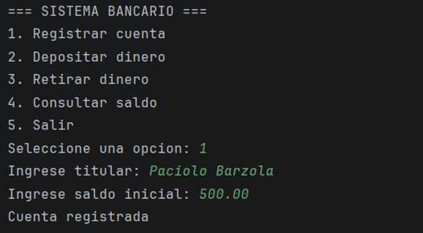
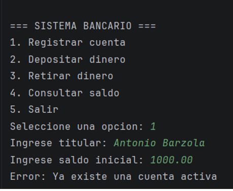
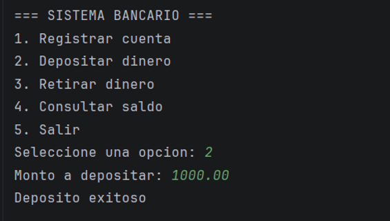
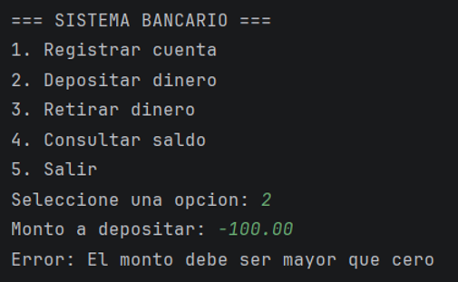
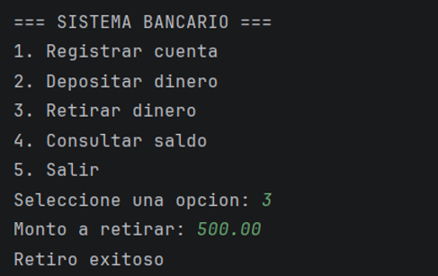
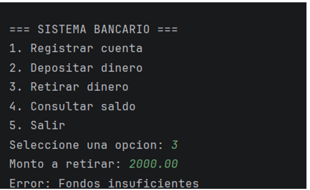

PRUEBAS FUNCIONALES

## Casos de prueba

### P01. Registrar una cuenta

**Objetivo:** verificar que el sistema permita registrar una cuenta bancaria correctamente.

### P02. Impedir el registro de una segunda cuenta

**Objetivo:** comprobar que el sistema no permita reemplazar una cuenta que ya se encuentra registrada.

### P03. Realizar un depósito

**Objetivo:** verificar que se pueda incrementar el saldo de la cuenta mediante un depósito válido.

### P04. Rechazar un depósito inválido

**Objetivo:** comprobar que el sistema no permita realizar depósitos con cantidades negativas.

### P05. Realizar un retiro válido

**Objetivo:** comprobar que el sistema permita retirar dinero cuando existe saldo suficiente.

### P06. Rechazar un retiro superior al saldo disponible

**Objetivo:** comprobar que el sistema impida retirar una cantidad superior al saldo de la cuenta.

### P07. Consultar el saldo

**Objetivo:** verificar que el sistema muestre correctamente el saldo actualizado de la cuenta.

|

##  Conclusión

Las pruebas funcionales permiten comprobar que las operaciones principales del sistema se ejecutan de acuerdo con las reglas establecidas.

Se verificó el registro de una cuenta, la restricción de una segunda cuenta, los depósitos válidos y el rechazo de cantidades negativas.

También se contemplaron las pruebas de retiro, saldo insuficiente y consulta de saldo, con el propósito de comprobar que las operaciones no afecten incorrectamente el dinero disponible.

Las pruebas constituyen una evidencia del funcionamiento del sistema y permiten identificar posibles errores antes de considerar finalizada la implementación.