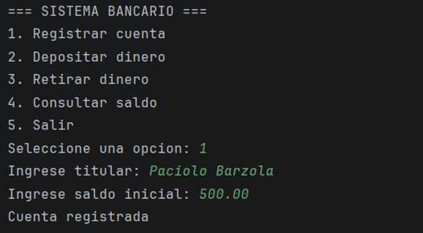
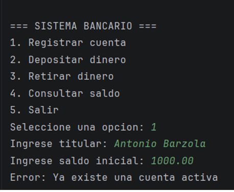
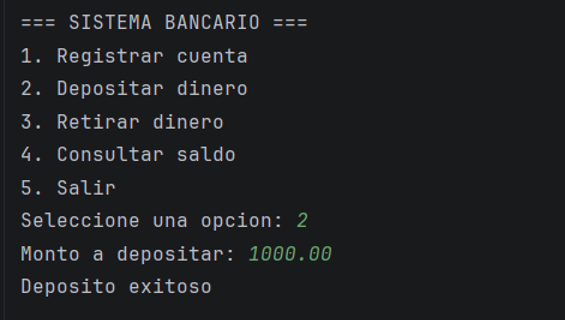
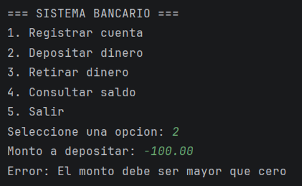
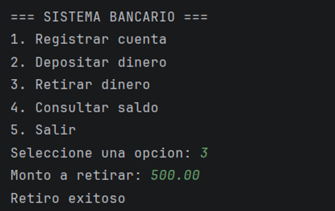
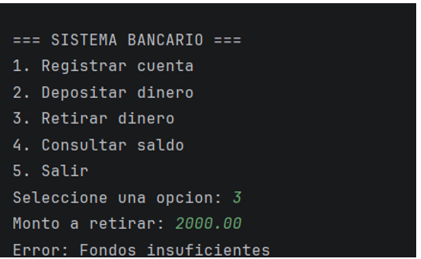

Diagnóstico de la arquitectura original

1. Situación inicial

El programa bancario original concentra todas sus responsabilidades en la clase `SistemaBancario`. En ella se realiza la captura de datos, validación de operaciones, actualización de saldos, almacenamiento de movimientos, presentación de resultados y coordinación del menú.

2. Responsabilidades identificadas

| Responsabilidad           | Problema identificado                           |
| ------------------------- | ----------------------------------------------- |
| Captura de datos          | Depende directamente de Scanner.                |
| Validación de operaciones | Está mezclada con la presentación.              |
| Actualización de saldos   | No está separada de la entrada de datos.        |
| Almacenamiento            | Depende directamente de FileWriter.             |
| Presentación              | Utiliza System.out en la misma clase.           |
| Coordinación              | El menú y las reglas bancarias están mezclados. |

3. Problemas encontrados

- Una sola clase concentra demasiadas responsabilidades.
- Existe acoplamiento entre las reglas bancarias y las herramientas externas.
- Cambiar el mecanismo de almacenamiento requiere modificar la clase principal.
- Registrar otra cuenta reemplaza los datos de la cuenta anterior.
- El uso de double puede ocasionar imprecisiones en los cálculos monetarios.

4. Justificación de la refactorización

Se propone aplicar arquitectura limpia para separar el dominio, la aplicación, los contratos de persistencia, la infraestructura y la presentación.

Para que cada componente tenga una responsabilidad específica y los cambios en tecnologías externas no afectarán directamente las reglas bancarias.

Captura de pruebas:

Prueba 1:

Prueba 2:

Prueba 3:

Prueba 4:

Prueba 5:

Prueba 6:
